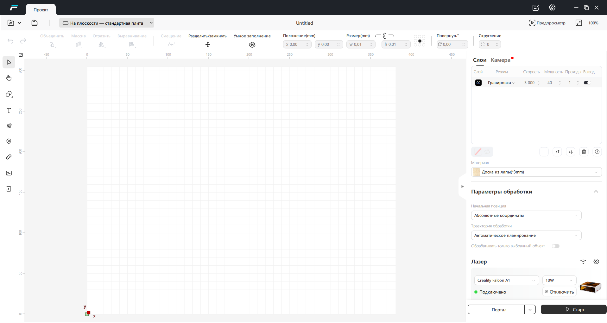
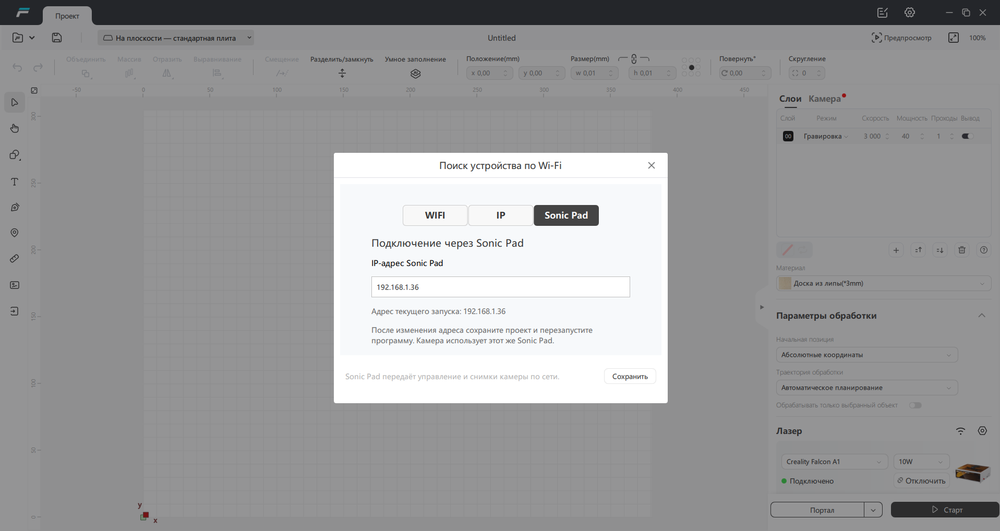
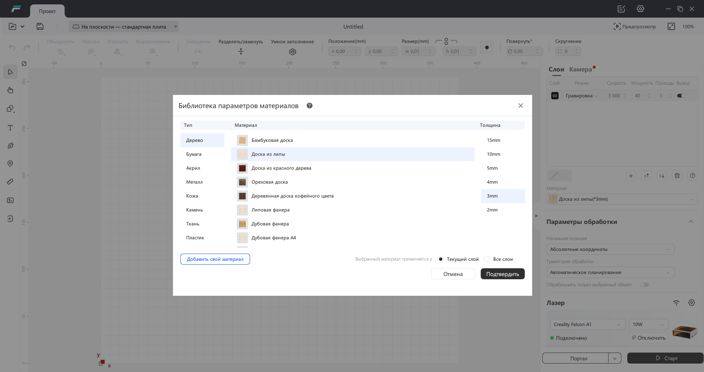
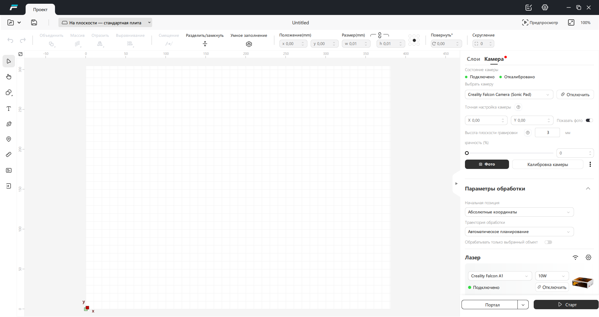

# Falcon Design Space + Sonic Pad: Falcon A1 по Wi‑Fi

**Русский интерфейс Falcon Design Space 1.8.0, управление Creality Falcon A1 через Creality Sonic Pad по сети, фотографии с камеры и офлайн-библиотека материалов.** Полный патч для Windows x64, исходники адаптеров и отдельный пакет службы Sonic Pad.

Это неофициальный пользовательский проект. Оригинальная Falcon Design Space принадлежит Creality. Страница проекта: [arandit21/Falcon-Design-Space-Sonic-Pad](https://github.com/arandit21/Falcon-Design-Space-Sonic-Pad).

## Скачать

Файлы патча для Falcon Design Space находятся в [релизе 1.3.0](https://github.com/arandit21/Falcon-Design-Space-Sonic-Pad/releases/tag/v1.3.0):

| Файл | Назначение |
| --- | --- |
| [Falcon_Design_Space_1.8.0_Original.exe](https://github.com/arandit21/Falcon-Design-Space-Sonic-Pad/releases/download/v1.3.0/Falcon_Design_Space_1.8.0_Original.exe) | Исходный установщик FDS 1.8.0, без изменений содержимого |
| [FalconSonicPad_Setup_1.3.0.exe](https://github.com/arandit21/Falcon-Design-Space-Sonic-Pad/releases/download/v1.3.0/FalconSonicPad_Setup_1.3.0.exe) | Установщик полного патча |
| [Falcon_SonicPad_Service_1.3.0.zip](https://github.com/arandit21/Falcon-Design-Space-Sonic-Pad/releases/download/v1.3.0/Falcon_SonicPad_Service_1.3.0.zip) | Служба R4, нативный ретранслятор, адаптер фото и установка на Sonic Pad вручную |
| [Falcon_Design_Space_FULL_PATCH_1.3.0.zip](https://github.com/arandit21/Falcon-Design-Space-Sonic-Pad/releases/download/v1.3.0/Falcon_Design_Space_FULL_PATCH_1.3.0.zip) | Патч, пакет службы и русская инструкция одним архивом; исходный установщик FDS скачивается отдельно |
| [Базовый NO_AUTH_PATCH для сборщиков](https://github.com/arandit21/Falcon-Design-Space-Sonic-Pad/releases/download/v1.3.0/Falcon_Design_Space_NO_AUTH_PATCH_20261011.zip) | Исходный базовый архив; при обычной установке нового патча не нужен |
| [SHA256SUMS.txt](https://github.com/arandit21/Falcon-Design-Space-Sonic-Pad/releases/download/v1.3.0/SHA256SUMS.txt) | Контрольные суммы файлов релиза |

Выпуск 1.3.0 предварительный: управление и камера проверены на рабочем A1; сценарий первой установки службы проверен изолированными тестами, но ещё не пройден на отдельной чистой Windows и сброшенном Sonic Pad. Подробности — [что проверено](docs/ПРОВЕРКИ.md).

## Комплексная русификация самого Sonic Pad

**[Экран + переносы текста + браузерный Fluidd одним пакетом](docs/SONIC_PAD_RUSSIAN_SUITE.md)** для Sonic Pad V1.0.6.54.20. Рабочий русский словарь экрана, проверка совместимости, резервная копия и возврат. [Скачать общий комплект](https://github.com/arandit21/Falcon-Design-Space-Sonic-Pad/releases/tag/sonic-pad-russian-54.20-v1.1.0). Новый общий установщик — предварительный выпуск; сценарии установки и отката проверены локально.

## Что умеет патч

- Подключает Falcon A1, физически соединённый USB-кабелем с Sonic Pad, к FDS на компьютере по Wi‑Fi или проводной локальной сети.
- Использует штатный протокол приложения: команды перемещения и ответы контроллера передаются через SSH без перевода в альтернативный протокол.
- Даёт нормальное перемещение стрелками с расстоянием и скоростью из интерфейса FDS; прежняя проблема микрошагов устранена.
- Добавляет вкладку **Sonic Pad** рядом с **WIFI / IP**. Адрес общий для управления и камеры.
- Добавляет **Creality Falcon Camera (Sonic Pad)** в список камер Qt/FDS. Кнопка **Фото** получает снимок **2592×1944** с камеры, подключённой к Sonic Pad.
- Сохраняет существующую калибровку пользователя. Чужая индивидуальная калибровка в публичный установщик не включена.
- Включает русификацию, офлайн-базу материалов и базовые изменения NO_AUTH_PATCH от 11.10.2026.
- Устанавливается в выбранную папку, создаёт ярлык Falcon с правильной иконкой, работает без консоли после первоначального сопряжения.
- Делает резервные копии изменяемых файлов и настроек, поддерживает восстановление.

Непрерывное видео не реализовано: камера работает через получение отдельных фотографий. Полный цикл реальной гравировки/резки в этом выпуске отдельно не подтверждён; подтверждены подключение, перемещения и фото. Проверенная конфигурация: Falcon A1, контроллер CV40, прошивка V1.0.6, Sonic Pad с Python 3.7 и FDS 1.8.0. Для других версий EXE/DLL установщик откажется применять несовместимый пакет.

## Как подключено

```text
Windows: Falcon Design Space + патч
                │
         локальная сеть / SSH
                │
          Creality Sonic Pad
             │         │
            USB       USB
             │         │
         Falcon A1   Falcon Camera
```

Sonic Pad и компьютер должны быть в одной доступной сети. Камера и контроллер — разные USB-устройства; появление одной камеры ещё не означает, что контроллер A1 подключён.

## Установка с нуля

1. Установите [оригинальную FDS 1.8.0](https://github.com/arandit21/Falcon-Design-Space-Sonic-Pad/releases/download/v1.3.0/Falcon_Design_Space_1.8.0_Original.exe). Закройте FDS после установки.
2. Подключите A1 к USB Sonic Pad, включите станок и подключите Sonic Pad к локальной сети. Узнайте IP-адрес Pad и обеспечьте доступ к SSH с root-учётной записью.
3. В Windows должен быть установлен **клиент OpenSSH**: команды `ssh`, `scp`, `ssh-keygen`. Проверка в PowerShell: `Get-Command ssh, scp, ssh-keygen`. Если команд нет, добавьте «Клиент OpenSSH» в дополнительных компонентах Windows.
4. Запустите `FalconSonicPad_Setup_1.3.0.exe`, подтвердите UAC и выберите папку. По умолчанию это `C:\Program Files\Falcon Design Space\Sonic Pad`.
5. Согласитесь выполнить первоначальную настройку. В открывшемся окне введите IP Sonic Pad. При первом SSH-соединении сверяйте отпечаток своего устройства, затем введите root-пароль. Пароль не отображается и не сохраняется в патче.
6. Настройка создаст индивидуальный RSA-ключ, добавит его публичную часть на Pad и установит совместимую службу R4. Если установленная R4 уже подходит, её регистрация и работающие процессы сохраняются. **Отдельно устанавливать службу вручную в этом варианте не требуется.**
7. После завершения запускайте **Falcon — Sonic Pad** с рабочего стола. Для повторного сопряжения есть пункт **Falcon — настройка Sonic Pad** в меню Пуск.
8. В FDS подключите A1 штатной кнопкой. Для фото откройте вкладку **Камера**, выберите **Creality Falcon Camera (Sonic Pad)**, подключите её и нажмите **Фото**.

Sonic Pad должен иметь `python3` версии не ниже 3.7, `ffmpeg`, `sha256sum` и систему служб `/etc/rc.common`. Проверка установки сообщит о недостающих компонентах. Root-пароль и отпечаток SSH различаются у устройств; универсальный пароль в инструкции не используется.

## Установка службы Sonic Pad отдельно

[Полная инструкция с командами SSH/SCP, проверкой, автозапуском и удалением](docs/SONIC_PAD.md).

Кратко: распакуйте `Falcon_SonicPad_Service_1.3.0.zip`, перенесите его файлы на Pad и выполните:

```sh
cd /mnt/UDISK/falcon_sonicpad_service
python3 install_service.py check
python3 install_service.py install
/etc/init.d/falcon_a1_bridge status
```

Автозапуск относится к диагностической службе **R4**. Нативный ретранслятор команд запускается программой Windows через SSH только на время работы FDS; это разные процессы. Проверенная логика управления USB и камеры не переписана. В новой установке HTTP R4 и порты ретранслятора слушают только loopback Sonic Pad; публиковать их в интернет не нужно.

## IP-адрес и камера

В окне подключения FDS выберите **Sonic Pad**, введите адрес и нажмите **Сохранить**. Сохраните проект и перезапустите FDS. Это меняет адрес для следующего запуска; уже открытое соединение автоматически не переносится. При ошибке запуска окно также предлагает изменить IP. Для другого физического Sonic Pad выполните новое сопряжение через меню Пуск.

Калибровка относится к конкретной камере и её геометрии установки. Патч сохраняет профиль, если он уже есть. На свежем компьютере для точного позиционирования нужна собственная калибровка/восстановление своего профиля. Зелёная отметка на скриншотах относится к рабочей установке автора, а не обещает заводскую калибровку любого станка.

## Скриншоты

### Русский интерфейс и подключённый A1


### Вкладка Sonic Pad рядом с WIFI и IP


### Офлайн-библиотека материалов


### Камера Sonic Pad в штатном интерфейсе FDS


## Обновление, восстановление и диагностика

Перед обновлением закройте FDS и её запускатель. Существующие IP, SSH-ключ и профиль камеры сохраняются. Изменяемые данные находятся в `%LOCALAPPDATA%\FalconSonicPad\Data`, журналы — в `results` внутри этой папки. Для прежней установки в AppData путь может оставаться `%LOCALAPPDATA%\FalconSonicPad\FDS`.

В меню Пуск есть **Falcon — восстановление настроек**: восстанавливаются сохранённые настройки и исходные файлы приложения; установленная папка патча остаётся. Резервные копии — `backups` в папке патча. [Решение типовых ошибок](docs/УСТАНОВКА_И_ОШИБКИ.md).

## Исходники и сборка

- [`src/native`](src/native) — исходный проверенный нативный транспорт и фотоадаптер.
- [`src/windows`](src/windows) — установщик, запускатель, окно IP, первичное SSH-сопряжение.
- [`sonic-pad`](sonic-pad) — диагностическая служба и её установка, нативный ретранслятор и захват фото.
- [`tests`](tests) — изолированные проверки установки, сохранения настроек и службы.
- [Как собрать пакет](docs/СБОРКА.md), [сведения о сторонних компонентах](NOTICE_RU.md).

Приватные ключи, пароли, authorized_keys, журналы рабочего устройства и индивидуальная калибровка автора не публикуются. Машиночитаемое краткое описание проекта — [llms.txt](llms.txt).

**Ключевые слова:** Falcon Design Space русский язык, русификация Falcon Design Space 1.8.0, Creality Falcon A1 Wi‑Fi, Sonic Pad лазерный станок, камера Falcon A1 по сети, USB через SSH, офлайн-материалы FDS, патч Falcon Design Space Windows.
